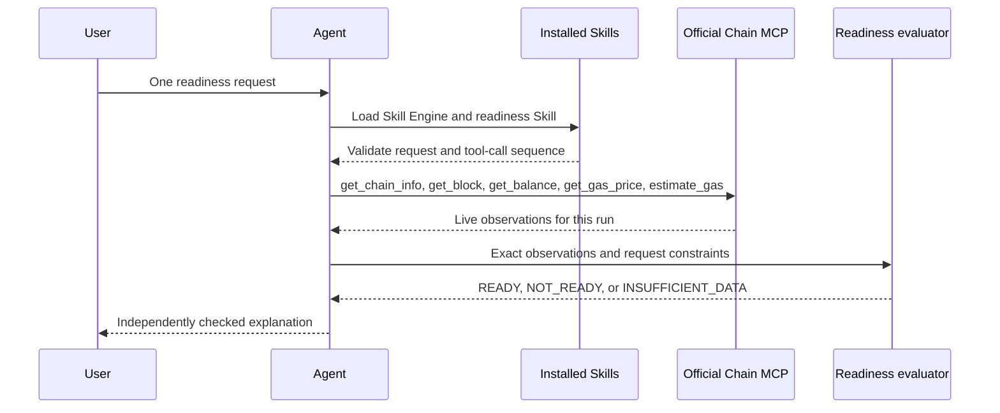

# Pharos Transfer Readiness

This project contains a read-only Skill + Chain MCP flow and a live dashboard that queries the official Pharos Chain MCP endpoint. The readiness result uses exact integer arithmetic for a native PROS transfer, modeled gas, and retained reserve.

## Flow



The dashboard also calls the public Streamable HTTP MCP endpoint at `https://mcp.pharos.xyz/mcp` from its Pages Function. Each submission generates a `chain-flow-<uuid>` run ID, pins the native balance to the fetched block, estimates the exact requested transfer, and reports both the block timestamp (`observedAt`) and fetch timestamp (`fetchedAt`). Gas price and gas estimate are live observations but are not block-pinned by the official tools.

The dashboard performs live MCP reads and deterministic evaluation; it does not itself run an LLM or invoke the Skill Engine. For the genuine Skill composition, use the installed Skills and agent instructions in `SKILL.md`.

## Install the Skills

From an agent environment with access to the official Skills CLI and Pharos Chain MCP:

```bash
npx skills add https://github.com/PharosNetwork/pharos-skill-engine
npx skills add .
```

Follow `SKILL.md` for the one-request tool order and evaluator input contract. A genuine agent run requires official Chain MCP observations to be passed to the evaluator in that same run. The dashboard makes live MCP requests but does not invoke the Skill Engine or count as agent-run proof.

## Run locally

```bash
npm ci
npm test
npm run check
npm run dev
```

Open the local URL printed by Wrangler. Enter only the sender, recipient, transfer amount, and retained reserve; the dashboard fetches fresh chain observations on each submission. It applies a default 100 gwei gas-price ceiling and a 20% gas buffer.

The evaluator can also be called directly with a JSON request:

```bash
node scripts/evaluate-readiness.mjs < request.json
```

`request.json` must contain `constraints` and `observations` as documented in `SKILL.md`. Decimal token amounts and wei values are strings; `bufferBps` is a non-negative integer.

## Deploy the live dashboard

The Pages Function makes outbound requests to the public Pharos MCP endpoint; no MCP credential is required. After authenticating with Wrangler and creating a Cloudflare Pages project, deploy the static page and function with:

```bash
npx wrangler pages deploy public --project-name=pharos-transfer-readiness
```

The local `npm run dev` preview compiles and serves the Pages Function from `functions/`.

## Safety and evidence status

- Pacific Mainnet only: chain ID `1672`, native token `PROS`, 18 decimal places.
- Read-only. No key handling, signing, transaction broadcast, funding, or contract deployment.
- The project only invokes read-only MCP tools: `get_chain_info`, `get_block`, `get_balance`, `get_gas_price`, and `estimate_gas`.
- Missing, invalid, or mismatched observations fail closed; no fallback data is substituted.
- The public MCP service is rate limited; repeated submissions may be rejected temporarily.
- Gas-price and gas-estimate observations may be newer than the balance block. The response exposes the latest block time and fetch time separately.
- The dashboard is live MCP evidence, but an agent-loaded Skill + Chain MCP run should still be captured separately for task submission.

Task: [Skill + Chain MCP Flow](https://pharos-agent-arena.vercel.app/tasks/skill-chain-mcp-flow)
