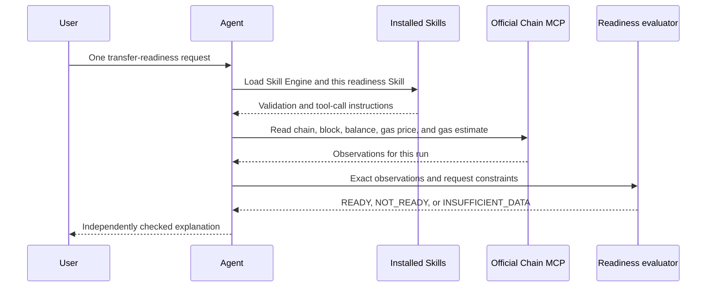

# Pharos Transfer Readiness

This project contains a read-only Skill + Chain MCP flow and a separate reviewer companion for evaluating supplied Pharos observations. The readiness result uses exact integer arithmetic for a native PROS transfer, modeled gas, and retained reserve.

## Flow



The browser page is not the agent runtime. It is a deterministic companion that calculates against values supplied by the user. It does not call Chain MCP or invoke the Skill Engine, and it identifies the supplied observations as unverified. Its illustrative example is not chain data.

## Install the Skills

From an agent environment with access to the official Skills CLI and Pharos Chain MCP:

```bash
npx skills add https://github.com/PharosNetwork/pharos-skill-engine
npx skills add .
```

Follow `SKILL.md` for the one-request tool order and the evaluator input contract. A genuine run requires the official Chain MCP observations to be passed to the evaluator in that same run. Do not treat companion output or test fixtures as live proof.

## Run locally

```bash
npm test
npm run check
npm run dev
```

Open the local URL printed by Wrangler. Use **Load illustrative example** to exercise the companion; the loaded values are explicitly not live or historical chain observations. For a meaningful check, enter observations captured in one actual Chain MCP run.

The evaluator can also be called directly:

```bash
node scripts/evaluate-readiness.mjs < request.json
```

`request.json` must contain `constraints` and `observations` as documented in `SKILL.md`. Decimal token amounts and wei values are strings; `bufferBps` is a non-negative integer.

## Deploy the reviewer companion

After authenticating with Wrangler and creating a Cloudflare Pages project, deploy the static page and Pages Function with:

```bash
npx wrangler pages deploy public --project-name=pharos-transfer-readiness
```

The local `npm run dev` preview compiles and serves the Pages Function from `functions/`. A deployed companion is not evidence of a genuine Skill + Chain MCP run.

## Safety and evidence status

- Pacific Mainnet only: chain ID `1672`, native token `PROS`, 18 decimal places.
- Read-only. No key handling, signing, transaction broadcast, funding, or contract deployment.
- Missing or invalid observations fail closed; no fallback values are substituted.
- The companion cannot verify whether user-supplied observations are genuine.
- This checkout does not yet include a genuine Chain MCP run proof, public demo URL, or Git remote. Those must be produced from the actual agent/deployment environment before submission.

Task: [Skill + Chain MCP Flow](https://pharos-agent-arena.vercel.app/tasks/skill-chain-mcp-flow)
